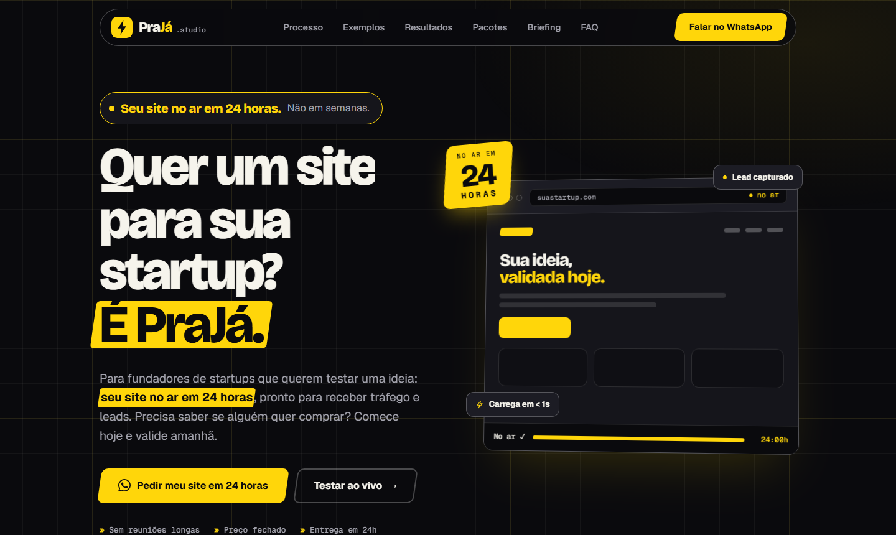

<div align="center">

# PraJá.studio

**Quer uma página pro seu negócio? É PraJá.**

Landing page de um estúdio fictício que entrega páginas para startups em **um dia**.
Projeto de estudo feito com HTML, CSS e JavaScript puros, em um único arquivo.

[**Ver demo ao vivo →**](https://praja-studio.vercel.app)



</div>

> [!WARNING]
> **Protótipo fictício, feito para fins de estudo e didáticos.**
> A marca PraJá.studio, os pacotes, os preços, os prazos, as condições de pagamento, as garantias, os números dos painéis e o telefone de WhatsApp `(00) 00000-0000` são **inventados**. Este projeto não representa um negócio real nem oferece nenhum serviço.

## Sobre o projeto

A ideia era criar uma landing page que **vende velocidade** para startups que precisam validar ideias rapidamente, e que mostra domínio de front-end no próprio processo: identidade visual própria, interações com propósito, acessibilidade e desempenho, sem frameworks e sem etapa de build.

Tudo o que a página promete aparece nela de alguma forma: o selo "1 dia", o relógio no mockup, o horário de corte calculado em tempo real e o briefing que monta a mensagem pronta para o WhatsApp.

## O que tem na página

| Seção | O que faz |
|---|---|
| **Hero** | Promessa principal, mockup de navegador que começa pronto e de tempos em tempos "refaz" a página, e CTA para o WhatsApp |
| **Comparação** | Agência × no-code sozinho × PraJá, em prazo, esforço, preço, copy e design e posse da página |
| **Processo** | Como cabe tudo em um dia, horário de corte (15h) e linha do tempo guiada pelo scroll |
| **Exemplos** | Galeria de quatro páginas fictícias (lista de espera, pré-venda, software e evento) com identidades visuais diferentes, que se montam peça por peça ao entrar na tela e podem ser ampliadas |
| **Resultados** | Painel ilustrativo de teste de demanda e o que a pessoa leva depois da entrega |
| **Briefing** | Duas formas de preencher: teste ao vivo (prévia, nota de clareza e comparação A/B) ou briefing escrito à mão, com pacote indicado e horário previsto de entrega |
| **Pacotes e garantias** | Três pacotes de preço fechado e as garantias (código, hospedagem, custos e entrada) |
| **FAQ e CTA final** | Objeções mais comuns e uma última chamada para o WhatsApp |

## Destaques técnicos

**Interação**
- **Briefing com duas formas de preencher:** a aba **Teste ao vivo** e a aba **Escrever meu briefing**. A segunda tem uma caixa de texto com exemplo (digitado na tela ao clicar em "Usar exemplo") e atalhos para inserir tópicos, e a mensagem do WhatsApp sai com o texto escrito.
- **Teste ao vivo em 4 passos:** formato (lista de espera, pré-venda, software ou evento), ideia com sugestão de frase, cor e tom de voz, e prazo. A prévia muda de layout por formato, pode ser vista em modo computador ou celular e troca texto, cor e blocos com transições animadas.
- **Teste da promessa:** nota de clareza de 0 a 100 para a frase principal (tamanho, benefício, número ou prazo, jargão e leitura), calculada enquanto a pessoa digita. Dá para criar uma **variação B**, comparar as duas lado a lado, ver qual vence e escolher qual aparece na prévia. É uma heurística simples, não uma garantia de conversão.
- **Horário previsto de entrega** calculado pelo **horário de Brasília** (e não pelo relógio de quem visita), com a regra do corte às 15h, fins de semana e próximo dia útil. A lógica foi testada em vários fusos.
- **Painel de resultados animado:** as barras crescem em sequência, os números contam até o valor final, e depois o painel simula novas visitas, cliques e cadastros ao vivo (dados ilustrativos). Cada barra mostra um detalhe ao passar o mouse ou receber foco.
- Galeria que monta cada exemplo peça por peça ao entrar na tela (e de novo na janela ampliada, um `<dialog>` que leva ao WhatsApp com o nome do exemplo na mensagem).
- Brilho que segue o cursor, spotlight nos cards, inclinação 3D no mockup do hero e linha do tempo que se preenche conforme a leitura.
- Poucos caminhos para o WhatsApp, cada um com um papel: topo (desktop) ou barra fixa (celular), hero, briefing, pacotes e CTA final. As faixas do meio levam ao briefing.
- No celular, um botão "voltar ao topo" aparece depois que a pessoa rola a página até o fim (e some ao voltar ao início); fica acima da barra fixa e respeita `prefers-reduced-motion`.
- No celular, menu compacto e uma faixa que mostra a prévia do briefing ao vivo enquanto a pessoa preenche.

**Acessibilidade**
- Link para pular ao conteúdo, foco visível por teclado e navegação por setas nas opções do briefing.
- Estados `aria-checked` e `aria-pressed` nas escolhas, e `prefers-reduced-motion` respeitado.

**Desempenho**
- Sem bibliotecas de JavaScript nem etapa de build: a página inteira é um único arquivo HTML.
- As fontes da galeria só são carregadas quando a seção se aproxima da tela.
- Layout responsivo, testado de desktop a celular.

## Identidade visual

O conceito é **velocidade elétrica**: tudo na página deriva do raio do logotipo.

| Elemento | Decisão |
|---|---|
| **Cores** | Fundo escuro (`#0a0a0d`), texto creme (`#f6f4ec`) e **amarelo-raio** (`#ffd60a`) usado só como destaque |
| **Formas** | Paralelogramos inclinados em botões, grifos, selo e marcadores, na mesma inclinação do raio |
| **Ícones** | Conjunto próprio de ícones de traço (SVG), com o mesmo desenho |
| **Tipografia** | **Archivo** na largura expandida nos títulos, **Inter** no texto e **JetBrains Mono** nos detalhes técnicos |
| **Detalhes** | Filete amarelo no topo dos blocos-chave, divisores inclinados entre as seções e movimento seco e rápido |

A galeria é de propósito um contraponto: cada exemplo (Grana, Torra, Fluxo e Sprint Zero) tem cores, fontes e layout próprios, para mostrar que dá para fazer qualquer coisa.

## Estrutura do projeto

```
.
├── index.html        # Página completa (HTML + CSS + JS inline)
├── assets/
│   ├── og.html       # Fonte da imagem de compartilhamento
│   ├── og.png        # Imagem social (1200x630) das metatags Open Graph
│   ├── apple-touch-icon.png  # Ícone para a tela inicial do iPhone
│   └── preview.png   # Captura usada neste README
├── vercel.json       # Cabeçalhos de segurança e cache
├── LICENSE
└── README.md
```

## Rodando localmente

Não há dependências nem etapa de build. Abra o `index.html` no navegador ou sirva a pasta:

```bash
npx serve .
```

## Personalização

| O que mudar | Onde |
|---|---|
| Número do WhatsApp | constante `WHATSAPP_NUMBER` no final do `index.html` (DDI + DDD + número, só dígitos). Enquanto o número for só zeros (fictício), os botões abrem uma janela mostrando a mensagem que seria enviada; com um número real, abrem o WhatsApp direto |
| Telefone exibido | `.phone`, na seção final |
| Nome e logotipo | `<title>`, metatags, SVG do logotipo no header e `assets/og.html` |
| Cores | variáveis CSS em `:root`, no início do `<style>` |
| Preços e pacotes | seção `#pacotes` |
| Horário de corte | função `eta()` no script do briefing, o texto do card de corte e o FAQ |
| Imagem de compartilhamento | edite `assets/og.html` e capture a tela em 1200x630 |

## Deploy

O site é estático e é publicado na [Vercel](https://vercel.com) a partir deste repositório. Cada push na branch `main` gera um novo deploy automaticamente.

## Licença

Distribuído sob a licença MIT. Veja [LICENSE](LICENSE).
